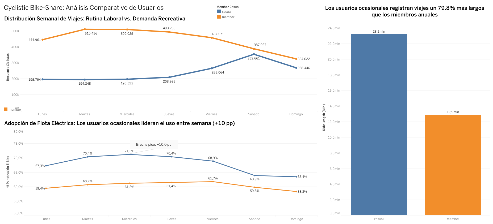

# 🚴‍♂️ Caso de Estudio Cyclistic Bike-Share


Estrategia de Conversión de Ciclistas Ocasionales a Miembros Anuales: Auditoría de 4,810,648 Viajes Certificados

## 1. Resumen Ejecutivo (Answer-First)

Para maximizar el crecimiento rentable de Cyclistic mediante la conversión de ciclistas ocasionales en miembros anuales, la empresa debe **pivotar su enfoque desde el marketing masivo de fin de semana hacia la captura quirúrgica de usuarios frecuentes de bicicletas eléctricas y commuters híbridos**.

Este análisis demuestra que el mayor potencial de conversión no reside en el turista de fin de semana, sino en el **millón de viajes casuales (63.03% del total) que ocurren de lunes a viernes**, fuertemente apalancados por una alta adopción de la flota eléctrica (hasta 71.20% los miércoles).

## 2. El Problema (Ask)

El equipo directivo y financiero de Cyclistic determinó que las membresías anuales son sustancialmente más rentables que los pases de viaje único o de día completo. El objetivo comercial de este proyecto es analizar el comportamiento diferencial entre los miembros anuales y los usuarios ocasionales sobre los datos históricos de 12 meses, para diseñar estrategias de conversión y campañas de marketing digital basadas en evidencia.

## 3. Datos y Limpieza (Prepare & Process)

El proyecto implicó la extracción, consolidación y limpieza de un gran volumen de datos transaccionales generados por una red de 5,824 bicicletas y 692 estaciones en Chicago.

* **Herramientas:** Python (Pandas, NumPy) para ingesta, cálculo de duraciones y limpieza; Tableau Public para la visualización ejecutiva.
* **Volumen:** Se procesaron 6.17 millones de registros brutos de 12 meses en formato Parquet, aplicando reglas estrictas de depuración (eliminación de nulos críticos, viajes < 1 minuto por falsos desbloqueos y pruebas operativas de mantenimiento) para obtener un dataset final auditado de **4,810,648 viajes válidos**.
* **Resolución de Restricciones (PII):** Debido a normativas de privacidad, no se contaba con información de identificación personal (PII) ni tarjetas de crédito para rastrear usuarios únicos. Este obstáculo se resolvió diseñando un modelo de proxies comportamentales (cruzando día de la semana, hora, duración, tipo de flota y estaciones residenciales vs. laborales) para aislar a los residentes locales de los turistas de paso.

## 4. Análisis y Hallazgos Clave (Analyze)

El análisis cuantitativo sobre los casi 5 millones de registros reveló tres hallazgos contraintuitivos que rompen con los supuestos tradicionales del negocio:

* **El 63.03% de los viajes ocasionales ocurre de lunes a viernes:** De 1,682,831 viajes casuales, 1,060,724 suceden en días hábiles (con un piso constante de ~195,000 a 209,000 viajes diarios de lunes a jueves). Existe un "segmento oculto" de trabajadores híbridos y residentes locales que utilizan el servicio de manera constante entre semana.
* **Pico de Adopción Eléctrica a Mitad de Semana (+10.0 pp):** La bicicleta eléctrica (`electric_bike`) es el verdadero motor de adquisición. Los usuarios ocasionales la eligen en el 67.4% de sus trayectos, alcanzando un récord de **71.20% de adopción los miércoles** (superando sistemáticamente a los miembros anuales con una brecha de hasta +10.04 puntos porcentuales).
* **Asimetría en la Duración del Viaje (+79.8%):** Los usuarios ocasionales realizan viajes significativamente más largos (23.2 minutos en promedio frente a los 12.9 minutos de los miembros). Al combinar trayectos más extensos con el uso intensivo de flota eléctrica, el ciclista casual recurrente sufre una alta fricción económica por cargos por minuto y tarifas de desbloqueo.

## 5. Visualización (Share)

Los hallazgos han sido consolidados en un panel ejecutivo interactivo de tres vistas, diseñado para facilitar la toma de decisiones del Comité Directivo:



* **Panel Superior (Tendencia Semanal de Volumen):** Gráfico comparativo de líneas (`member` vs. `casual`) evidenciando el piso laboral casual y el pico de miembros los martes (510,456 viajes).
* **Panel Inferior Izquierdo (Curva de Penetración de Flota Eléctrica):** Visualización de la brecha de uso eléctrico de lunes a domingo con pico de miércoles.
* **Panel Inferior Derecho (Duración Media del Viaje):** Contraste de 23.2 min vs. 12.9 min con línea de referencia tarifaria en el minuto 15.

## 6. Recomendaciones Estratégicas (Act)

Para convertir la fricción tarifaria del usuario casual en suscripciones anuales completas (protegiendo el margen unitario de las E-Bikes y la disponibilidad de flota), se proponen tres iniciativas respaldadas por un protocolo de pruebas A/B de 8 semanas:

* **In-App Instant Ride-Credit Rollover:** Al finalizar un viaje casual >20 min o en bicicleta eléctrica, bonificar el 100% del costo recién pagado como descuento directo hacia la Membresía Anual mediante un pop-up temporizado en la aplicación móvil, capitalizando el momento de dolor de pago.
* **E-Bike Commuter Pass ($0 Unlock Fee) con Rebalanceo Gamificado:** Campaña geocercada ofreciendo desbloqueo bonificado de bicicletas eléctricas para miembros anuales, acompañada de incentivos de minutos gratis cuando el usuario estaciona en estaciones deficitarias ("Estaciones Verdes") antes de las 8:30 AM para reducir costos logísticos de camiones.
* **Programa Weekend-to-Weekday Bridge en Estaciones Residenciales:** Secuencia automatizada dominical para usuarios casuales del fin de semana, ofreciendo desbloqueos eléctricos bonificados de lunes a jueves durante 14 días al suscribirse, incluyendo reserva prioritaria para el 8% de usuarios de flota asistida/inclusiva.

## 7. Entregables y Estructura del Repositorio

El repositorio se encuentra estructurado en carpetas modulares para facilitar su navegación y reproducibilidad:

```text
├── deliverables/
│   ├── Cyclistic_Presentacion_Ejecutiva_Final.pptx   # Deck ejecutivo de 12 slides para Directores
│   └── Cyclistic_Caso_Estudio_Completo.md            # Documentación exhaustiva con tablas maestras
├── notebooks/
│   └── Cyclistic_Data_Pipeline.ipynb                 # Notebook de Jupyter con todo el flujo analítico
├── src/
│   └── cyclistic_pipeline.py                         # Script modular en Python para ETL y limpieza
├── data/
│   ├── 01_metricas_semanales_ebikes.csv              # Agregado certificado por día, usuario y e-bike
│   └── 02_patrones_horarios_demanda.csv              # Agregado de distribución horaria de viajes
├── assets/
│   └── tableau_dashboard.png                         # Captura del dashboard interactivo
├── .gitignore
└── README.md
```

* **Presentación Ejecutiva:** [Ver Presentación Ejecutiva en `/deliverables`](./deliverables/Cyclistic_Presentacion_Ejecutiva_Final.pptx)
* **Pipeline en Python:** [Script de Procesamiento en `/src`](./src/cyclistic_pipeline.py)
* **Datos Procesados:** [Extractos Analíticos en `/data`](./data/)
