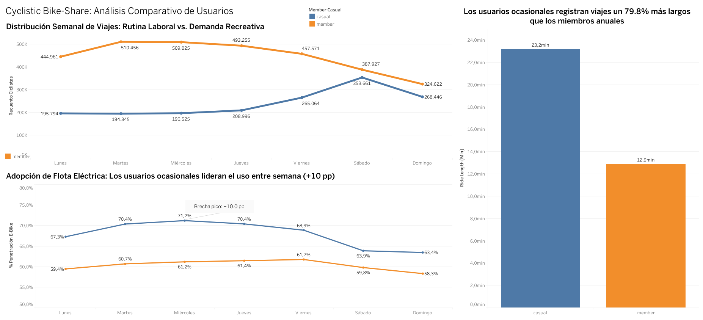

# 🚴‍♂️ Cyclistic Bike-Share Case Study


> **Conversion Strategy: From Casual Riders to Annual Members across 4,810,648 Certified Trips**  
> **Author:** Juan E. Lund — Operations & Partner Manager | Data & Decision Scientist  
> **Language:** **English** | [Versión en Español](README.es.md)

---

## 1. Executive Summary (Answer-First)

To maximize Cyclistic's profitable growth by converting casual riders into annual members, the company must **pivot its marketing strategy away from broad weekend leisure promotions toward surgical, mid-week acquisition of hybrid commuters and frequent electric bike adopters**.

This analysis demonstrates that the greatest untapped conversion potential does not reside in the weekend tourist, but in the **1.06 million casual trips (63.03% of total casual volume) taking place Monday through Friday**, strongly driven by electric fleet adoption that peaks at **71.20% on Wednesdays**.

---

## 2. Business Problem & Objective (Ask)

Cyclistic's executive leadership and finance teams determined that annual memberships generate significantly higher lifetime margins and recurring revenue than single-ride or full-day passes.

* **Business Objective:** Analyze 12 months of historical trip data to uncover behavioral differences between annual members and casual riders, and design targeted digital conversion campaigns without eroding operational unit economics.
* **Privacy & Governance Constraint (No PII):** Under data privacy regulations, the dataset excludes personally identifiable information (PII) and credit card tokens. Recurrence and user intent were modeled using **spatiotemporal behavioral proxies** (combining day of week, hour of day, trip duration, fleet type, and residential vs. commercial station clusters).

---

## 3. Data Ingestion & Cleaning Pipeline (Prepare & Process)

The pipeline processed transactional data across a fleet of 5,824 bicycles and 692 stations in Chicago.

* **Stack:** Python (Pandas, NumPy) for ETL, schema standardization, and duration modeling; Tableau Public for executive visualization.
* **Audit Funnel:**
  * Raw consolidated records (12 monthly files): **6,171,785 rows**.
  * Depuration rules: Removed false unlock trips (< 60 seconds), maintenance depot test runs (`HQ QR`), and null station identifiers.
  * Operational noise discarded: **1,361,137 rows (22.05%)**.
  * Certified population: **4,810,648 valid trips** (3,127,817 annual members [65.02%] and 1,682,831 casual riders [34.98%]).

---

## 4. Key Quantitative Findings (Analyze)

The quantitative audit revealed three counterintuitive findings that redefine commercial strategy:

1. **63.03% of Casual Trips Occur on Weekdays ($1,060,724$ of $1,682,831$):**
   * Although Saturday has the single highest daily volume (353,661 trips), nearly two-thirds of annual casual volume happens Monday through Friday, maintaining a consistent baseline of ~195,000 to 209,000 trips daily. This segment represents hybrid workers and local residents with high conversion propensity.
2. **Electric Bike Adoption Peaks Mid-Week (+10.0 pp Gap):**
   * Electric bikes (`electric_bike`) are the primary vehicle for casual acquisition. Casual riders select e-bikes in **67.4% of their annual trips**, reaching record peaks of **71.20% on Wednesdays**, systematically outpacing annual members (60.5% average; up to a +10.04 percentage point penetration gap).
3. **Trip Duration Asymmetry (+79.8% Longer):**
   * Casual trips average **23.2 minutes**, compared to **12.9 minutes** for members. Combining longer rides with per-minute electric fees subjects frequent casual riders to high pricing friction at checkout.

---

## 5. Executive Visualization (Share)

Findings were consolidated into an interactive three-view executive dashboard:



* **Top View (Weekly Volume Trends):** Visualizes the casual weekday commuter baseline vs. Tuesday member peak (510,456 rides).
* **Bottom Left (E-Bike Penetration Curve):** Highlights the adoption gap Monday through Sunday peaking at mid-week.
* **Bottom Right (Average Duration Asymmetry):** Highlights 23.2 min vs. 12.9 min relative to the 15-minute pricing threshold.

---

## 6. Strategic Recommendations & A/B Experimentation (Act)

* **In-App Instant Ride-Credit Rollover:** At the conclusion of a casual trip >20 min or on an electric bike, credit 100% of the newly incurred ride fee directly toward an Annual Membership via a timed pop-up, capitalizing on the exact moment of payment friction.
* **E-Bike Commuter Pass ($0 Unlock Fee) with Gamified Rebalancing:** Geofenced campaign offering waived unlock fees for annual members, paired with free-minute incentives when docking at deficit stations ("Green Docks") before 8:30 AM to cut truck rebalancing costs.
* **Weekend-to-Weekday Bridge Program:** Automated Sunday sequence targeting weekend leisure casuals, offering subsidized electric unlocks Monday through Thursday for 14 days upon subscription.

---

## 7. Repository Structure

```text
cyclistic-bike-share-analysis/
├── deliverables/
│   ├── Cyclistic_Presentacion_Ejecutiva_Final.pptx   # 12-slide executive deck with speaker notes
│   ├── Cyclistic_Caso_Estudio_Completo.md            # Comprehensive case documentation
│   └── Cyclistic_Log_Auditoria_Metodologica.md       # Methodological changelog
├── notebooks/
│   └── Cyclistic_Data_Pipeline.ipynb                 # End-to-end analytical Jupyter Notebook
├── src/
│   └── cyclistic_pipeline.py                         # Modular Python ETL and cleaning script
├── data/
│   ├── 01_metricas_semanales_ebikes.csv              # Aggregated metrics by day and fleet
│   └── 02_patrones_horarios_demanda.csv              # Hourly demand distribution
├── assets/
│   └── tableau_dashboard.png                         # Interactive dashboard preview
├── README.es.md                                      # Spanish version of documentation
├── requirements.txt
└── README.md                                         # Primary English documentation
```

---

### Links & Deliverables
* 📊 **Executive Presentation:** [Download Deck in `/deliverables`](./deliverables/Cyclistic_Presentacion_Ejecutiva_Final.pptx)
* 💻 **Python Pipeline:** [Modular Script in `/src`](./src/cyclistic_pipeline.py)
* 📈 **Tableau Dashboard:** [View on Tableau Public](https://public.tableau.com/app/profile/juan.lund)
